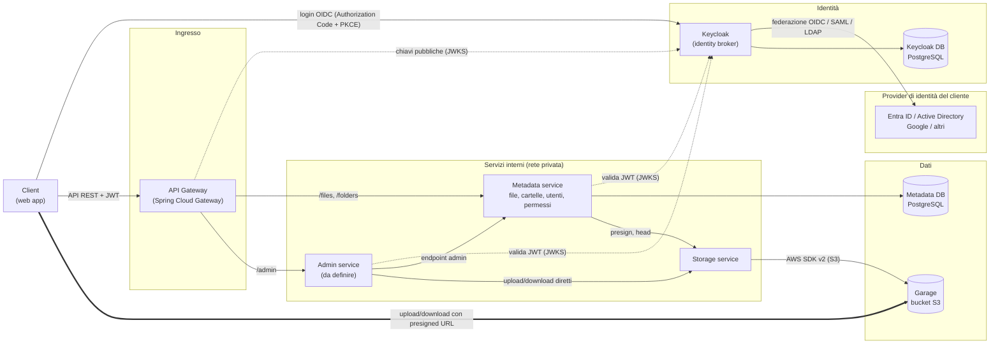

# Kubo

Kubo è un clone open source di Google Drive, realizzato in Java con un'architettura a microservizi per archiviare, organizzare e condividere file.

## Architettura

Linee tratteggiate: validazione dei token (i servizi scaricano una volta le chiavi pubbliche di Keycloak e poi validano da soli). Linea spessa: i byte dei file vanno dal client a Garage senza passare da gateway né da servizi. Lo Storage non ha rotta nel gateway ed è raggiungibile solo dai servizi interni.

## Microservizi

Stato: per ora è realizzato solo lo `storage-service`; gli altri sono progettati.

| Servizio | Ruolo | Stato |
|---|---|---|
| **API Gateway** (Spring Cloud Gateway) | Unico punto d'ingresso per il client: instrada le richieste, verifica il JWT, gestisce CORS e rate limiting. Senza logica di business e senza database. | Previsto |
| **Keycloak** (identità) | Non è codice nostro: è un container che gestisce il login ed emette i JWT, al posto di un Auth service. Fa da identity broker verso Microsoft Entra ID / Active Directory, Google e altri, che i servizi vedono come un unico issuer. Il ruolo di amministratore (es. `kubo-admin`) è definito qui. | Previsto |
| **Metadata service** | Il cuore del sistema: file, cartelle, utenti (copia locale creata al primo accesso dal token) e permessi con ereditarietà dalle cartelle. Non tocca mai i byte dei file. Controlla "questo utente può farlo?" a ogni operazione. | Previsto |
| **Admin service** | Dashboard per gestire i file indipendentemente da chi li ha creati. Non gestisce gli utenti, che restano in Keycloak e nel provider del cliente. | Da definire |
| **Storage service** | L'unico che conosce Garage: presigned URL (anche multipart per i file grandi), conferma degli upload con una HEAD, pulizia dei multipart abbandonati. Senza utenti né permessi, raggiungibile solo dai servizi interni. | Realizzato |

---

### storage-service

Si occupa di leggere e scrivere i file nel bucket. Non gestisce utenti né permessi: è pensato per essere chiamato solo da altri servizi.

- **Si collega a:** Garage, l'object storage S3-compatibile definito nel `docker-compose.yml`, tramite l'AWS SDK per Java v2.
- **Cosa espone:**
  - generazione di presigned URL per upload e download, con cui il client trasferisce i file direttamente da e verso il bucket (`/api/presign`);
  - upload e download diretti, che fanno passare i byte dal servizio (`/api`).
- **Configurazione:** copia `storage-service/.env.example` in `storage-service/.env` e compila i valori.
- **Endpoint interno e pubblico:** `GARAGE_ENDPOINT` è l'indirizzo con cui il servizio parla con Garage; `GARAGE_PUBLIC_ENDPOINT` è quello con cui il client lo raggiunge e finisce negli URL firmati (l'host fa parte della firma). Se vuoto, vale `GARAGE_ENDPOINT`.

#### Dipendenze

Java 25 e Spring Boot 4.1.2, con Maven (wrapper `./mvnw`).

| Dipendenza | A cosa serve |
|---|---|
| `spring-boot-starter-webmvc` | API REST (controller, JSON, upload multipart) |
| `software.amazon.awssdk:s3` (2.57.3, tramite BOM) | Client S3 e `S3Presigner` per parlare con Garage |
| `springdoc-openapi-starter-webmvc-ui` (3.1.0) | Documentazione OpenAPI e Swagger UI |
| `lombok` | Riduce il codice ripetitivo (costruttori, ecc.) |
| `spring-boot-configuration-processor` | Metadati delle proprietà `kubo.s3.*` per l'IDE |
| `spring-boot-devtools` | Riavvio automatico in sviluppo |
| `spring-boot-starter-webmvc-test` | Test (solo scope test) |

## Infrastruttura

### Garage

[Garage](https://garagehq.deuxfleurs.fr) è un object storage open source, scritto in Rust e pensato per il self-hosting. Espone un'API compatibile con Amazon S3, quindi il codice scritto con l'AWS SDK funziona anche con altri backend S3 cambiando solo la configurazione. Kubo lo usa al posto di MinIO.

- **Bucket e chiavi:** i file stanno in un bucket e si accede con una coppia access key / secret key. Il bucket e la chiave si creano con la CLI di Garage o dalla web UI.
- **Layout:** un nodo non accetta richieste finché non gli viene assegnato un layout (zona e capacità), anche con un solo nodo.
- **Region:** non è geografica, è un'etichetta (`garage`) che deve essere uguale in `garage/garage.toml`, nel `.env` e nel client Java.
- **Stile degli URL:** path-style (`http://host:3900/bucket/chiave`), senza `root_domain`.
- **Limiti:** niente versioning né notifiche degli eventi, e una sola replica con un nodo, quindi non è adatto alla produzione così com'è.

Il `docker-compose.yml` avvia due servizi:

| Servizio | Immagine | Porta | Ruolo |
|---|---|---|---|
| `garage` | `dxflrs/garage` | 3900 (S3), 3903 (Admin API) | Object storage |
| `garage-webui` | `khairul169/garage-webui` | 3909 | Interfaccia web per layout, bucket e chiavi |

I dati sono nei volume `garage-meta` e `garage-data`. Le porte sono legate a `127.0.0.1` (cambia `GARAGE_BIND_ADDRESS` per esporle). La configurazione del nodo è in `garage/garage.toml`, mentre i segreti (`GARAGE_RPC_SECRET`, `GARAGE_ADMIN_TOKEN`) stanno nel `.env` della radice. Per partire, copia `.env.example` in `.env` e compilalo.

Attenzione: `docker compose down -v` cancella anche i volumi, quindi tutti i file caricati e il layout.
