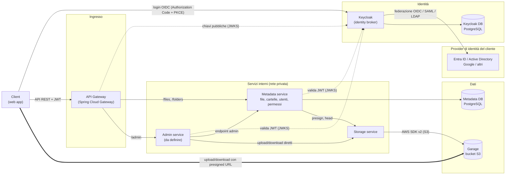

# Appunti 

Clone opensouce di google drive, per aumentare le mi skill di java.

### Architettura

Linee tratteggiate: validazione dei token (i servizi scaricano le chiavi pubbliche di Keycloak una volta e poi validano da soli). Linea spessa: i byte dei file vanno dal client a Garage senza passare da gateway né da servizi. Lo Storage non ha rotta nel gateway.

Suddivizione dei Microservizi:

1. API Gateway (Spring Cloud Gateway)
È l'unico punto d'ingresso per il client. Instrada le richieste verso il servizio giusto, verifica il JWT, gestisce CORS e rate limiting. Non ha logica di business e non ha database.

2. Keycloak (identità)
Non è un servizio scritto da noi: è un container che gestisce login ed emette i JWT, al posto di un Auth service. Fa da identity broker: il cliente collega i propri provider (Microsoft Entra ID / Active Directory via OIDC, SAML o LDAP, Google, ...) e Keycloak li presenta ai nostri servizi come un unico issuer, con claim uniformi. Gli altri servizi non lo chiamano a ogni richiesta: validano il JWT da soli (Spring Security come resource server, con un solo issuer-uri) e leggono l'identità dai claim sub e iss. Il ruolo di amministratore (es. kubo-admin) è definito in Keycloak, anche a partire dai gruppi dell'AD, e arriva nel token.

3. Metadata service
È il cuore del sistema. Possiede la tabella files (e le cartelle, quando le aggiungi): crea, rinomina, sposta, cestina, elenca il contenuto di una cartella. Non tocca mai i byte dei file, gestisce solo i metadati. A ogni operazione deve chiedersi "questo utente può farla su questo file?".
Possiede anche la tabella users, una copia locale creata al primo accesso dal token: UUID interno, issuer ed external_id (univoci insieme, perché lo stesso id può ripetersi tra provider diversi), nome, email. File, cartelle e permessi puntano all'UUID interno, mai all'id del provider.
Gestisce anche i permessi (tabella permissions): condivide un file con un utente, assegna un ruolo, revoca, e risolve l'ereditarietà dei permessi dalle cartelle ai file contenuti. Sono due pacchetti separati nello stesso servizio (files e permissions), perché i permessi dipendono dalla gerarchia delle cartelle, che sta qui.

4. Admin service
(da definire) Dashboard per gestire i file indipendentemente da chi li ha creati. Non gestisce gli utenti, che restano in Keycloak e nel provider del cliente.

5. Storage service
È l'unico che conosce Garage. Genera le presigned URL (anche multipart per i file grandi) e conferma gli upload con una HEAD sull'oggetto (dimensione e content-type), chiamata dal Metadata, perché Garage non ha notifiche degli eventi. Non ha utenti né permessi ed è raggiungibile solo dal Metadata (e dall'Admin), mai dal gateway. Isolarlo tiene in un solo servizio le credenziali del bucket e tutto ciò che riguarda lo storage.

### Scheam ER

### Librerie

API Gateway
- spring-cloud-starter-gateway: il nome dello starter è cambiato nelle release recenti (gateway-server-webflux / gateway-server-webmvc), quindi controlla quello della tua versione
- spring-boot-starter-oauth2-resource-server: valida il JWT all'ingresso
- spring-cloud-starter-circuitbreaker-reactor-resilience4j: opzionale, circuit breaker e fallback
- spring-boot-starter-data-redis-reactive: opzionale, solo se vuoi il rate limiting (RequestRateLimiter)

Niente database, niente JPA. Il gateway è reattivo (WebFlux), quindi non mischiare spring-boot-starter-web.

Keycloak
Nessuna libreria: è un container (immagine quay.io/keycloak/keycloak, con un database proprio). Gateway, Metadata, Admin e Storage (se serve) sono solo resource server, con un solo issuer-uri che punta al realm di Keycloak.

Meta-Service
spring-boot-starter-web
spring-boot-starter-oauth2-resource-server
spring-boot-starter-data-jpa
postgresql
flyway-core + flyway-database-postgresql
mapstruct + mapstruct-processor: mapping entity ↔ DTO. Se usi anche Lombok, aggiungi lombok-mapstruct-binding
Per chiamare Storage non serve nulla di extra: Spring ha già RestClient e le interfacce dichiarative @HttpExchange. spring-cloud-starter-openfeign è l'alternativa classica
resilience4j-spring-boot3: opzionale, retry e timeout per le chiamate tra servizi

Admin-Service
(da definire)

Storage-Service
- spring-boot-starter-web
- spring-boot-starter-oauth2-resource-server
- software.amazon.awssdk:s3 (AWS SDK v2, con software.amazon.awssdk:bom): include S3Presigner per le presigned URL. È la mia scelta, perché funziona con qualsiasi backend S3-compatibile (MinIO, SeaweedFS, Garage)
